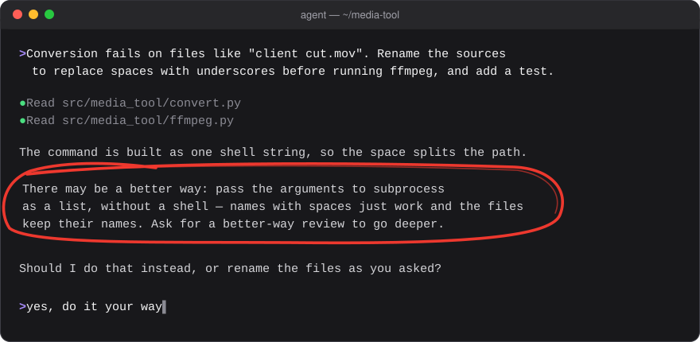

# better-way

Your agent says in one line when a better route than the one you proposed reaches your goal — before it starts.



**Install:** `npx skills add artmhm1/better-way -g` — or just tell your agent: "Install the better-way skill from https://github.com/artmhm1/better-way".

## Why

You say what you want (the goal) and often how to do it (the route): in code, a product plan, a sales pitch, a text. The route is a guess. Agents usually either follow it to the letter or quietly do something else. better-way makes them say it out loud, once, and leaves the call with you. It is the XY problem, caught where it is cheapest to fix.

> There may be a better way: send the client the existing case study instead of a new deck. Ask for a better-way review to go deeper.

## What it does

- **Quick check, before acting.** Before a task where you prescribed the route, the agent checks whether a clearly better one reaches the same goal. If yes, one line before acting. If the route is fine or the difference is taste, it says nothing.
- **Full review, on request.** Ask for a better-way review of a plan, an epic or the current discussion: for each decision — the goal, your route, a verdict (agree / partly / better route), the price of the alternative and the cheapest check.

## Install

```bash
npx skills add artmhm1/better-way -g      # any agent; drop -g for this project only
```

### Claude Code

```text
/plugin marketplace add artmhm1/better-way
/plugin install better-way@better-way
```

### Codex

```bash
codex plugin marketplace add artmhm1/better-way
codex plugin add better-way@better-way
```

### Other agents

```bash
npx skills add artmhm1/better-way -g --agent '*'
```

Without the CLI, copy `skills/better-way/` into your agent's skills folder: global (`~/.claude/skills/`, `~/.agents/skills/`) or per project (`.claude/skills/` for Claude Code, `.agents/skills/` for most others).

## Recommended: one line in AGENTS.md

The skill works without it. In our runs the line helped smaller models a little, and the sample is too small to tell whether that is noise. Add to AGENTS.md / CLAUDE.md:

```
- The user's goal is the decision; a route the user proposes (a method, a tool, an architecture, an order of work) is a hypothesis. If you see a better route, say so in one line, in the user's language, before acting: "There may be a better way: <route>. Ask for a better-way review to go deeper." The user's answer settles it.
```

## Does it work?

A basic A/B check on coding tasks: 9 models across Claude Code, Codex and Cursor, 15 small tasks in realistic projects; in 11 of them the prompt prescribes a worse route.

- **Without the skill**, agents mention a better route before acting in about 1 task in 10. In about 3 in 10 they quietly do something else instead.
- **With the skill**: about 7 in 10 overall, and 9–10 in 10 for strong and mid-size models (Claude Opus and Sonnet, GPT-6.1 Sol, GPT-6 Astra, Grok 4.6/4.7).
- **Small models** (Claude Haiku, Composer 2.5) barely change. GPT-6 Luna reaches about half, and the AGENTS.md line helps it a little.
- No false alarms on tasks where the prescribed route was fine, and no wrong suggestions.

Rough numbers: one run per model and setup. Not measured outside coding yet.

## License

MIT
